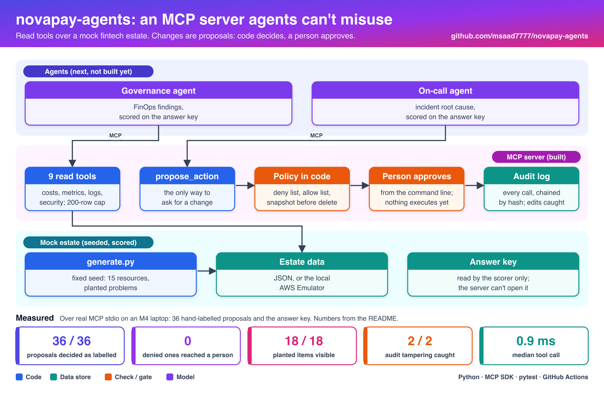

# NovaPay agents

A governance agent (FinOps lead) and an on-call agent for a fictional fintech, NovaPay, built for the AI Agents
course final projects. Everything runs on a seeded mock environment with planted problems and an answer key, so
results can be measured. Mock prices are not AWS list prices.

**Work in progress.** Done: the mock environment, its optional AWS Emulator mode, and the MCP server with
guardrails (below). The agents that use the server come next, so there are no agent results yet.



## The mock estate

`python -m novapay_agents.generate` writes the estate with a fixed seed:

- **Inventory:** 15 resources (7 EC2, 2 RDS, 3 EBS, 1 NAT gateway, 2 S3 buckets) in `ca-central-1`.
- **Costs:** 30 days of daily FOCUS-style cost rows, plus team budgets and commitments.
- **Operations data:** 14 days of hourly metrics and 31 log events.
- **Security and state:** a security snapshot and Terraform state.

The answer key lists 12 governance findings, 3 incidents and 3 decoys, which look suspicious but are fine. It's
written to `data/answer_key/`, outside the folder the agents read.

## Two sources, same shapes

| Source | What it is | Use it for |
|---|---|---|
| JSON (default) | `data/novapay/*.json` | tests, fast runs, no Docker |
| AWS Emulator (optional) | the same estate, built through real AWS APIs in [AWS Emulator](https://github.com/aws/aws-emulator) on this machine | checking that tools work against AWS-shaped APIs, with no AWS account |

`novapay_agents.aws_env` seeds the emulator and reads it back in the same shapes as the JSON files, so agent
tools can take either source.

| Mock data | Where it lives in the emulator |
|---|---|
| EC2 instances, EBS volumes, security groups, NAT gateway | EC2 API, in one VPC and subnet |
| RDS instances | RDS API |
| S3 buckets: tags, encryption, public access | S3 API: bucket tags, default encryption, public access block, bucket policy |
| Hourly metrics | CloudWatch, custom namespace `NovaPay/Mock` |
| Logs | CloudWatch Logs group `/novapay/app`, one stream per source |
| On-call wiring (emulator only) | SNS topic `novapay-oncall` and one alarm on checkout p95 latency |
| Time shift (see below) | SSM parameter `/novapay/seed/time-shift-hours` |

Costs, budgets, commitments and Terraform state stay in JSON: billing data can't be emulated.

### Measured round trip

AWS Emulator 1.0.338 in Docker (colima) on an Apple M4 laptop, 2026-11-13. The seed is read back and compared
item by item with the JSON (`aws_env check`):

| Check | Matched |
|---|---|
| Inventory resources | 15 / 15 |
| Security groups (rules and attachments) | 3 / 3 |
| S3 buckets (public read, encryption) | 2 / 2 |
| Instance metadata settings (IMDS) | 4 / 4 |
| Metric data points | 10,416 / 10,416 |
| Log events | 31 / 31 |

Seeding took 1.7 s and the check took 0.5 s (wall clock, one run each).

### What failed along the way

- **CloudWatch rejected the first seed.** Like AWS, it only accepts data points from the last two weeks, and the
  mock window is in October. The seed now moves every metric and log timestamp forward by a whole number of hours
  and stores that number in SSM; reading back moves them back. Hour-of-day patterns, like the nightly batch, keep
  their original times when read through `read_back`. Viewed directly in CloudWatch, they're shifted.
- **The first read-back lost every metric point** (0 / 10,416). Hourly buckets start at the query's start time,
  which wasn't on a whole hour, so every timestamp came back 35 minutes off. The query now starts on the hour.
- **AWS doesn't allow security group names starting with `sg-`**, so `sg-web` is the group `novapay-web` with a
  `Name` tag of `sg-web`.
- **One PutLogEvents batch can't span more than 24 hours.** Logs are sent in day-sized batches.

### Modelling choices to know about

- **The mock attaches an EBS volume to an RDS database** (`vol-0c3` to `db-01`), which AWS doesn't allow. In the
  emulator it's an unattached volume tagged `novapay:attached-to=db-01`, and `read_back` reports it as in use.
- **S3 bucket sizes** (used for storage costs) are kept in a `novapay:size-gb` tag.
- **Instances the mock gives no IMDS setting get IMDSv2 required,** so the emulator doesn't add IMDSv1 findings
  that the answer key doesn't have.
- **Instance root volumes** that the emulator creates are left out of the inventory, as in the mock.

### Limits of the emulator

- **It doesn't evaluate IAM.** Nothing here proves least privilege or that a tool is read-only; that has to be
  tested another way.
- **One Region and one account, in memory.** Restart the container before seeding again. It has no reset API.
- **Fidelity varies by service.** AWS publishes conformance scores with each release (`scores.json.gz` on the
  [releases page](https://github.com/aws/aws-emulator/releases)). For v1.0.338, the release used here:

| Service | Scored tests passed, whole service | Test steps that call the operations this repo uses |
|---|---|---|
| EC2 | 770 / 1,731 (44%) | 715 / 882 (81%) |
| RDS | 240 / 482 (50%) | 25 / 31 (81%) |
| S3 | 1,014 / 1,226 (83%) | 550 / 573 (96%) |
| CloudWatch | 645 / 848 (76%) | 224 / 277 (81%) |
| CloudWatch Logs | 480 / 643 (75%) | 253 / 253 (100%) |
| SNS | 239 / 284 (84%) | 39 / 39 (100%) |
| SSM | 108 / 457 (24%) | 44 / 44 (100%) |

  Only single-service tests are counted. The round trip above is what this repo actually relies on.

- **Alarms:** the emulator set the checkout alarm's state to `OK` after the seed. Nothing here tests whether it
  would go into `ALARM` or notify SNS, so don't rely on that.

## MCP server and guardrails

`uv run python -m novapay_agents.server` starts an MCP server over stdio. Agents get read tools and one way to ask
for a change:

| Tool | What it returns |
|---|---|
| `list_inventory` | resources, filtered by kind, env or team (`team="untagged"` finds unowned ones) |
| `cost_summary`, `budget_status`, `get_commitments` | cost by team, service, resource or day; each team against its budget; Savings Plans and RIs |
| `get_metrics`, `find_metric_peaks` | summary of one hourly metric; the windows where it crosses a threshold |
| `search_logs` | log events by source, level, text and time, marked as untrusted data |
| `get_security`, `terraform_drift` | security groups, buckets, IMDS settings; resources missing from Terraform state |
| `propose_action` | a change request, checked by code against the policy |
| `get_request_status` | whether a person approved or denied a request |

Read tools carry MCP's read-only annotation, cap results at 200 rows, and can only open the estate's files: the
answer key isn't reachable from the server.

**The policy is code, not a prompt.** A proposal is:

- **denied** if it's on the deny list (terminate, delete a database or bucket, buy a Savings Plan or RI, change IAM,
  silence an alarm, delete logs or snapshots, free-form shell) or not on the allow list;
- **denied** if it's unsafe as asked: deleting an attached volume, deleting any volume before a person approves a
  snapshot of it, opening anything but 443 to the internet, cleaning up outside `/var/tmp` and `/tmp`;
- **invalid** for an unknown resource, the wrong kind of resource, missing or out-of-range parameters, or no reason;
- otherwise **queued for a person**, high risk for prod. A duplicate returns the request already waiting, and one
  agent can have at most 20 waiting.

Only a person approves, from the command line. The server has no approve, execute or delete tool, and approvals
must name a person. **Approving executes nothing in this version**; that comes with the on-call agent.

```bash
uv run python -m novapay_agents.guardrails list
uv run python -m novapay_agents.guardrails approve REQ-0001 --by saad
uv run python -m novapay_agents.guardrails verify        # check the audit log
```

Every tool call, proposal and decision is appended to `state/audit.jsonl`. Each line holds the hash of the line
before it, so an edited or deleted line is caught by `verify`.

### Measured

`uv run python eval/run.py` talks to the server over real stdio and writes
[`eval/results/results.json`](eval/results/results.json). Apple M4 laptop, 2026-11-14, one run.

| Check | Result |
|---|---|
| Proposals decided as labelled (16 to approve, 15 to deny, 5 invalid) | 36 / 36 |
| Denied or invalid proposals that reached the approval queue | 0 |
| Prod proposals marked high risk | 13 / 13 |
| Delete before / after a person approved the snapshot | denied / queued |
| Planted problems and decoys whose evidence is visible through the tools | 18 / 18 (22 checks) |
| Audit log: chain verifies; edited line caught; deleted line caught | yes; yes (line 5); yes |
| Rate limit set to 3: five proposals | 3 queued, 2 rate-limited |
| Tool call over stdio, 61 calls | p50 0.9 ms, p95 2.0 ms |

**What these numbers don't say.** The 36 proposals and their labels were written by the same person who wrote the
policy, so 36/36 shows the code does what was intended, not that the policy is complete. The evidence check shows
the facts are reachable, not that an agent will find them. The latency is a local stdio round trip on tiny data.

### What failed along the way

- **The first pending limit, 10, blocked 6 of 16 legitimate fixes.** One governance sweep of this estate proposes
  16 changes. The limit is now 20, and it's tested on its own.
- **The first leak check flagged an approved proposal as a leak** because it matched on action and resource only:
  `stop_instance dev-sandbox-01` with a reason and without one are different proposals. It now matches the whole
  proposal.

## How to run

Default mode, no Docker:

```bash
uv run python -m novapay_agents.generate
uv run python -m pytest
uv run python eval/run.py
```

AWS Emulator mode. Build the image once from AWS's
[Getting started with Docker](https://docs.aws.amazon.com/emulator/latest/userguide/getting-started-docker.html)
Dockerfile (on Apple silicon, use `aws-emulator-aarch64.rpm`), then start it with telemetry off and open only on
this machine:

```bash
docker build -t aws-emulator .        # in an empty folder outside this repo
mkdir -p ~/.aws/emulator
docker run -d --rm --name aws-emulator --memory=2g --memory-swap=2g -p 127.0.0.1:9297:9297 \
  -e HOME="$HOME" -v "$HOME/.aws/emulator:$HOME/.aws/emulator" aws-emulator -p 9297 --telemetry off
```

Then seed, check, and run the round-trip test:

```bash
uv sync --extra aws
source scripts/emulator-env.sh       # run-only keys, CA and a local endpoint; read again after each restart
uv run python -m novapay_agents.aws_env seed
uv run python -m novapay_agents.aws_env check
NOVAPAY_AWS_EMULATOR=1 uv run python -m pytest
```

`aws_env` refuses to run unless `AWS_ENDPOINT_URL` points at `127.0.0.1`, `localhost` or `::1`, so nothing can
reach real AWS. No AWS account is needed.

## Layout

```
src/novapay_agents/generate.py   seeded mock estate and answer key
src/novapay_agents/aws_env.py    optional AWS Emulator mode: seed, read back, check
src/novapay_agents/tools.py      read-only tools over the estate
src/novapay_agents/guardrails.py policy, approval queue, audit log, and the approval command line
src/novapay_agents/server.py     the MCP server
eval/actions.jsonl               36 labelled proposals
eval/run.py                      the measurements above, over stdio
scripts/emulator-env.sh          points boto3 at the local emulator
data/novapay/                    the estate as JSON (what agents read)
data/answer_key/                 planted problems and decoys (agents never read this)
docs/architecture.svg            the diagram above
```
